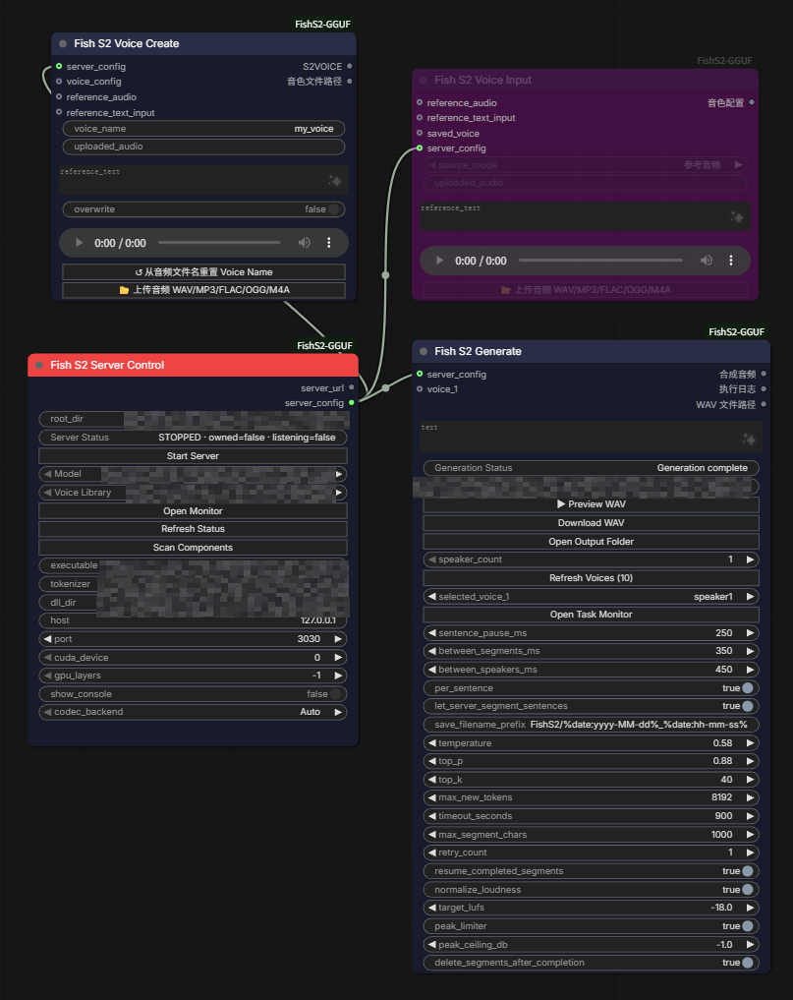
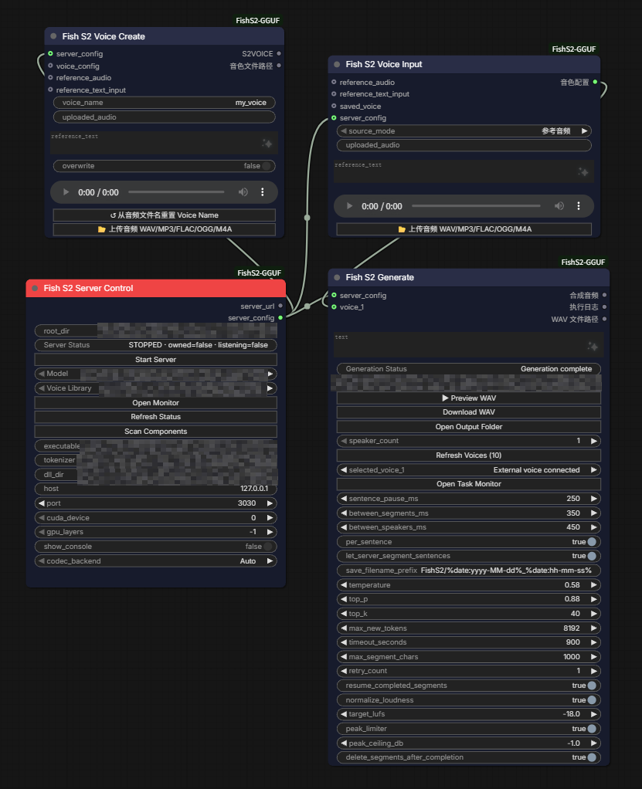

# ComfyUI-FishS2-GGUF

**Local Fish Audio S2-Pro GGUF text-to-speech for ComfyUI, powered by the independent [s2.cpp](https://github.com/rodrigomatta/s2.cpp) inference engine.** Multi-speaker workflows, voice reuse, native node controls, audio preview and WAV export.

**Maintained by [xuanhai0](https://github.com/xuanhai0)** · [English](README.md) | [简体中文](README.zh-CN.md)

> **Already have s2.cpp working? → [Jump straight to ComfyUI Node Setup](#comfyui-node-setup).** You do not need to rebuild it to use this plugin.
>
> **New to s2.cpp? → [Windows compilation & folder-layout guide](INSTALL_WINDOWS_S2CPP.md).** The engine was marked **ALPHA / EXPERIMENTAL** during this plugin's development (October 2026). [Original s2.cpp project](https://github.com/rodrigomatta/s2.cpp).

## TL;DR — check these first

| Checkpoint | Where to go |
|---|---|
| s2.cpp compiles with your **MSVC + CMake + CUDA Toolkit**, and the `ggml` submodule is present | [Windows build prerequisites](INSTALL_WINDOWS_S2CPP.md#build-prerequisites) |
| You found the **actual** `s2.exe`, DLL directory, GGUF and tokenizer; Windows Release paths may differ from Linux README examples | [Find the real paths](INSTALL_WINDOWS_S2CPP.md#file-layout-and-actual-build-outputs) |
| s2.cpp can create a WAV **without ComfyUI**, first from CLI and then HTTP | [Independent smoke tests](INSTALL_WINDOWS_S2CPP.md#validate-the-engine-before-comfyui) |
| Configure `Fish S2 Server Control`; connect `server_config` to `Fish S2 Generate` | [ComfyUI Node Setup](#comfyui-node-setup) |
| Confirm `gpu_layers=-1`, `codec_backend=Auto`, `per_sentence=true`, `let_server_segment_sentences=true` | [Key setting checks](#key-setting-checks) |
| Understand built-in saved voices versus overriding with `Fish S2 Voice Input` | [Two illustrated workflows](#illustrated-workflows) |

## Features and scope

- Control a local s2.cpp HTTP server: paths, start/stop, status, voice refresh, separate Server Monitor.
- Create reusable `.s2voice` profiles from reference audio + transcript with **Fish S2 Voice Create**.
- Generate 1–10 speakers with `[speakerN]` labels, built-in saved-voice selectors, or a per-speaker **Fish S2 Voice Input** override.
- Optional sentence segmentation within each request; segment logs and files, WAV preview/download, output-folder access and final loudness processing.
- ComfyUI-native node widgets; independent HTML monitors only in separate windows.

**Distribution:** this plugin ships no s2.cpp binaries/source, model weights, tokenizer files, user voices, or example reference audio. Those must be obtained separately. This is an independent community integration, not an official Fish Audio/ComfyUI release.

## Prerequisites and installation

- ComfyUI installed locally, with an appropriate Python environment (the plugin imports `torch`, `numpy`, `scipy` and `aiohttp` as part of its existing integration).
- A separately installed, functioning build of [s2.cpp](https://github.com/rodrigomatta/s2.cpp), plus a compatible [S2-Pro GGUF model](https://huggingface.co/rodrigomt/s2-pro-gguf), `tokenizer.json`, and a voice directory.
- Windows with NVIDIA CUDA was the development setup. Other platforms/backends are not claimed to be tested here.
- FFmpeg is useful for compressed reference-audio formats. It is **not** required to compile s2.cpp; the plugin attempts to discover it for applicable inputs.

**Installation:** back up any existing plugin folder and workflow JSON; close ComfyUI. Copy the contents of this repository into `ComfyUI/custom_nodes/ComfyUI-FishS2-GGUF/` (for the portable build, `ComfyUI_windows_portable/ComfyUI/custom_nodes/ComfyUI-FishS2-GGUF/`). Replace the old plugin directory rather than installing duplicate node copies. Restart ComfyUI and hard-refresh the browser (`Ctrl+F5`).

If you have not built s2.cpp yet, follow [Windows build: English](INSTALL_WINDOWS_S2CPP.md) / [Windows 编译：中文](INSTALL_WINDOWS_S2CPP.zh-CN.md). Verify independent CLI and HTTP synthesis **before** testing the nodes.

## Illustrated workflows

### Workflow A — saved-voice dropdown



Connect **Fish S2 Server Control → Fish S2 Generate** using their `server_config` sockets. The Generate node's `selected_voice_1` drop-down chooses a voice from the server's library; press **Refresh Voices** after creating new profiles. **Fish S2 Voice Create** can save reusable profiles; it has its own `server_config` input. The purple **Voice Input** shown above is *not connected to Generate* in this example. No voice override is active.

### Workflow B — external voice overrides the selector



Connect **Server Control → Voice Input** via `server_config`, and connect **Voice Input → Generate `voice_1`** via its voice configuration output. The Generate node then displays **External voice connected**, and this input takes precedence over `selected_voice_1`. Connect further Voice Input nodes to `voice_2` etc. for additional speakers.

> These are wiring examples, **not** proof that the pictured server is running: the screenshots show `STOPPED`. Empty audio fields are intentional placeholders. All absolute local paths were obscured in the distributed images.

## ComfyUI Node Setup

**This section is the fast path for people whose s2.cpp CLI and HTTP server already work.**

1. Add **Fish S2 Server Control**, set `root_dir` to the s2.cpp project root, and click **Scan Components**. Check `executable`, `Model`, `Voice Library`, `tokenizer`, and `dll_dir` against the *actual* files. The scanner checks common locations; it is not a filesystem-wide search. If necessary, fill paths manually. Changing `root_dir` again may refresh/replace those selections.
2. Set `host=127.0.0.1`, `port=3030` (or your desired non-conflicting port), `cuda_device=0` and `gpu_layers=-1` for an NVIDIA CUDA setup. Choose **Codec Backend: Auto**. Click **Start Server**, then **Refresh Status** / **Open Monitor** to inspect the real log. Stop any independently launched server using the same port first.
3. Add **Fish S2 Generate**. Connect the **Server Control** `server_config` output to the Generate `server_config` input. Choose `speaker_count` and press **Refresh Voices** for the saved-voice dropdowns, or connect a **Fish S2 Voice Input** as in Workflow B.
4. Enter a short test line. For multiple voices, put `[speaker1]`, `[speaker2]`, etc. at the **start of each line**. Click **Queue Prompt**; inspect **Open Task Monitor**, then **Preview WAV** or **Download WAV** after success.
5. Optionally use **Fish S2 Voice Create** with matching reference audio + reference transcript to create a reusable `.s2voice` file; refresh voices on Generate afterward.

```text
[speaker1] Hello! This is a short test.
[speaker2] Hello from the second speaker.
```

For a single speaker, untagged plain text is accepted. The defaults are *new-node defaults*, not a migration of existing saved workflow values.

## Key setting checks

| Widget | Default in this preview | Interpretation |
|---|---|---|
| Server `gpu_layers` | `-1` | Offload all available transformer layers when CUDA is selected (`0` means no transformer offload). |
| Server `codec_backend` | `Auto` | Let s2.cpp benchmark the codec backends. |
| Generate `per_sentence` | `true` | Each `[speakerN]`-labeled line is a separate server request; no additional punctuation splitting by the plugin. |
| Generate `let_server_segment_sentences` | `true` | Send `segment_sentences=true` so the s2.cpp server can additionally segment sentences inside that request. |
| Generate `normalize_loudness` / `target_lufs` | `true` / `-18.0` | Final audio loudness handling. |
| Generate `peak_limiter` / `peak_ceiling_db` | `true` / `-1.0` | Peak limiting. |

**Known caveats:** previously saved workflows may restore older widget positions incorrectly, especially `target_lufs` and `peak_ceiling_db`. Check values after upgrading. The current partial-cache mechanism does **not** guarantee reliable automatic recovery when Queue Prompt is run again with a new timestamp-based output prefix. Successful runs normally delete their segment caches. True multi-request GPU batching is not implemented; s2.cpp may return HTTP 503 on concurrent synthesis requests. Always test with your own build.

## Licensing, support and acknowledgments

The original code and documentation in this plugin repository are released under [GNU GPL-3.0-only](LICENSE), **Copyright (C) 2026 xuanhai0**, to the extent the maintainer holds the necessary rights. Redistribution of covered modifications must comply with GPL-3.0; commercial use and sale of the GPL-covered plugin code are permitted. This license **does not** relicense Fish Audio S2-Pro model weights, tokenizer, s2.cpp, or any other third-party materials. Fish Audio S2-Pro weights and the upstream s2.cpp engine have separate Fish Audio Research License terms; commercial use of those components requires a separate agreement. Review [third-party notices](THIRD_PARTY_NOTICES.md) and upstream licenses before use. Voice cloning also requires appropriate consent and rights.

The maintainer provides this project on a best-effort, spare-time basis without promised support SLAs or guaranteed compatibility. This is a **v0.5.3 preview/release candidate**, not a fully regression-tested production build.

**Acknowledgments:** This project was created and repeatedly revised with **substantial help from OpenAI's ChatGPT**, including implementation drafts, debugging, code revisions, test planning, and documentation. **xuanhai0** directed the feature requirements, evaluated alternatives, performed local Windows testing, and maintains/releases the project. ChatGPT is acknowledged as an AI assistant, not an official project author, maintainer, or sponsor. See [ACKNOWLEDGMENTS.md](ACKNOWLEDGMENTS.md).
